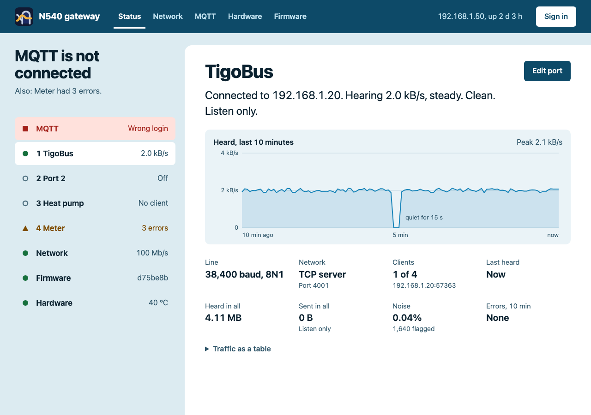

# Stopbit

Open firmware for the **USR-N540**, a 4-port RS485-to-Ethernet gateway, that replaces
the vendor's closed one. Bare-metal C on an STM32H750, with lwIP. A for-fun project: open,
hackable and observable, not a copy of the vendor's whole feature list.

Not made or endorsed by the vendor.

<picture>
  <source media="(prefers-color-scheme: dark)" srcset="docs/images/status-dark.png">
  
</picture>

*Example data.*

## What it does

- **RS485 to network.** Each port is a TCP server, TCP client, UDP endpoint or Modbus TCP
  gateway, with its own line settings, 300 to 2,000,000 baud.
- **Devices.** The gateway polls Modbus RTU devices itself and publishes their readings to
  MQTT, with Home Assistant discovery. One profile so far: the EG4 LifePower4 / LL battery,
  reading only. A Modbus port can serve its devices without listening on the network.
- **Status page.** A verdict that names the fault, every part's state, and each port's last
  ten minutes of traffic. Works on a phone and with no internet. Light or dark follows the
  system, or is chosen in the header for that browser.
- **Listen only.** A port's transmitter can be turned off in hardware setup, so watching a
  live bus cannot disturb it.
- **Access lists.** Per port, by address: read, or read and write.
- **Alert if quiet.** Per port: silence, or no client, for a chosen time.
- **MQTT,** optionally over TLS, with Home Assistant discovery that can be turned off.
- **Prometheus** figures at `/metrics`, an **event log**, and a **settings file** to
  download and restore.
- **Updates over the network,** from the web page or the command line, into two slots, with
  up to seven images kept to go back to. An update that does not start is undone by
  the loader.
- **Console** (`tools/n540.py HOST`): the same settings, plus send, watch and traffic logs.
- **Reload button:** hold 3 to 15 seconds to get back to DHCP with no web password.

## How far it has been tested

On one gateway:

- All four ports with a USB-RS485 adapter, 9600 to 1,000,000 baud, both ways and
  request/reply, with no errors.
- A real bus at 38,400 baud: every packet checksum valid in each 30-second capture. It has
  carried that bus, listen only, since 25 November 2026.
- Measured on that bus: a packet goes out 1.76 ms after its last byte, 1.75 ms of that the
  silence that ends a packet; a restart takes the network away for 0.8 s; a client that
  stops reading has 17 KB held for it before it misses anything (a port in loopback).
- A real EG4 battery, polled over Modbus RTU at 9600 baud beside that bus.
- MQTT over TLS to Mosquitto with a Let's Encrypt certificate, and HTTPS renewing its own
  certificate.
- Update, rollback and refusal of bad images.

Every push also runs the host tests, a simulator of the web server and installs, MQTT over
TLS against Mosquitto, and a short fuzz of the parsers (GitHub Actions).

Not tested: all four ports busy at once, long or terminated buses, more than 1,000,000 baud,
power loss during an update, silence on the wire in listen only (checked by counters,
not measured), a real device since profiles were packed on 27 November 2026 (only a port
that does not answer, since), and an image built with `-DAPP_LTO=ON`. [GATEWAY.md](docs/GATEWAY.md) and [NETWORK-UPDATE.md](docs/NETWORK-UPDATE.md)
have the details.

## Security, plainly

- Use it on a network you trust. Pages are HTTP unless HTTPS is on, and **the ports' data
  sockets have no login**. A port can be limited to listed addresses, to read or to read
  and write; that goes by IP address, so it is not proof against someone who takes one
  over.
- Anyone on the network can view the pages. Changes need the web password, which is unset
  at first, or the update key. Neither crosses the network in clear.
- **The web password can install firmware**, which is full control. Replacing the loader and
  reading flash need the update key.
- HTTPS can be turned on, and renew its Let's Encrypt certificate through Route 53
  ([HTTPS.md](docs/HTTPS.md)); plain HTTP stays available beside it.
- MQTT can be encrypted, with the broker's certificate checked against the Let's Encrypt
  and Amazon roots. Without TLS, the broker's login crosses the network in clear. With
  changes allowed over MQTT, anyone who can publish to the broker can make them.

## Build

Needs CMake 3.20+, Ninja, Python 3, git and Arm's GCC toolchain **with newlib**. Homebrew's
`arm-none-eabi-gcc` lacks it; unpack [Arm's](https://developer.arm.com/downloads/-/arm-gnu-toolchain-downloads)
into `toolchain/` and CMake finds it. ST's HAL and CMSIS, and lwIP, are fetched at pinned
versions on the first configure.

```sh
cmake -B build -G Ninja -DCMAKE_TOOLCHAIN_FILE=cmake/gcc-arm-none-eabi.cmake
cmake --build build
```

| Output | |
|---|---|
| `build/app.bin` | the gateway |
| `build/loader_flash.bin` | the loader, for internal flash |
| `build/loader_ram.bin` | the same loader, run from RAM over SWD |

The first configure creates `secrets/n540.key`, the update key, and compiles it into both.
**Back it up:** without it, only SWD can replace the loader.

The version is the release tag when built from one (`2026.48.0`), else the short commit. It
is set when CMake configures, so run the first command again after committing.

`-DAPP_LTO=ON` makes `app.bin` about 16 KB smaller. It is off unless asked for.

## Releases

Tagged `YEAR.WEEK.N`, by ISO week. They carry no firmware files: every image holds the
update key it was built with, so build your own, and its key is yours.

## Install

**Already running this firmware:** choose `app.bin` on the Firmware page, or

```sh
tools/n540.py n540-xxxxxx.local update build/app.bin
```

The name comes from the gateway's MAC address. Then set the web password with
`tools/n540.py HOST passwd`.

**From the vendor's firmware** needs an ST-Link once. Read these first:

- It has been done on one unit. It erases the vendor's bootloader, and kept firmware later
  overwrites the rest. **Going back is unproven** and there is no tool for it: our backup of
  that bootloader is a single unverified read. Take your own
  backups and check them ([DUMPS.md](docs/DUMPS.md)).
- **An external watchdog resets the chip about every 1.6 s** unless PC10 toggles, even while
  halted, so long SWD flash writes get cut off and can leave the unit unbootable. Do not
  flash it over SWD directly.

Instead, start the loader from RAM, which writes nothing, and let it install itself:

```sh
tools/ramrun.sh HOST_WITH_STLINK          # OpenOCD over ssh; read the script first
tools/n540.py n540-xxxxxx.local selfupdate build/loader_flash.bin
tools/n540.py n540-xxxxxx.local update build/app.bin
```

## Hardware

| | |
|---|---|
| Processor | STM32H750VBT6, Cortex-M7 at 400 MHz |
| Flash | 128 KB internal (the loader), 2 × 2 MB GD25Q16 (firmware slots, kept firmware, settings) |
| Ethernet | IC Plus IP101G, 10/100 |
| RS485 | 4 × TI SN65HVD75 |
| Watchdog | UM706SS, external |

The app runs from RAM: internal flash is one 128 KB erase block, so it holds only the
loader. Pins, and how sure we are of each, are in [HARDWARE.md](docs/HARDWARE.md).

## Layout

```
src/loader/   boot, network update, slot choice
src/app/      ports, Modbus, devices, settings, MQTT, console, API
src/http/     web server shared by both
src/net/      Ethernet driver, lwIP glue
src/common/   flash, slots, watchdog, SHA-256
src/board/    the pin map
web/          the page, one file, built into the firmware
profiles/     device profiles, built into the firmware
tools/        n540.py (updates, console), SWD scripts
tests/        host, simulator, fuzz and on-device tests
docs/         GATEWAY, HARDWARE, NETWORK-UPDATE, DUMPS, HTTPS, ROADMAP
```

[PRODUCT.md](PRODUCT.md) and [DESIGN.md](DESIGN.md) record what the pages are for and how
they look. Plans are in [ROADMAP.md](docs/ROADMAP.md).

## License

[Apache 2.0](LICENSE)
